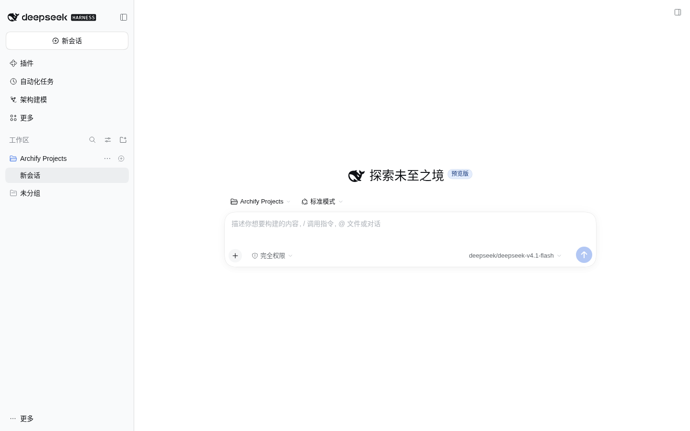
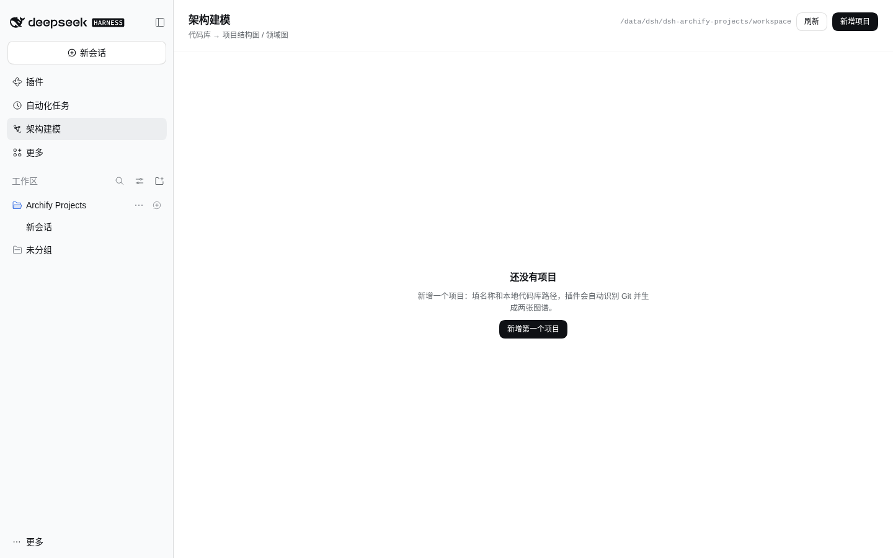
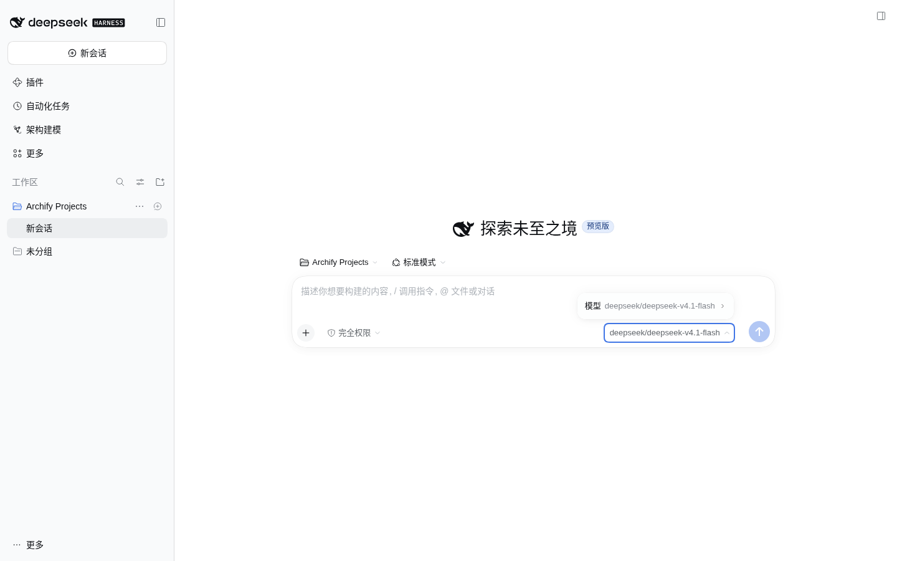

# 容器开发环境（dsh-dev）

> 面向：不想动宿主 `~/.dsh`、直接在隔离环境里改这个插件的 agent。
> 宿主直跑 / 热更的说明见 [HANDOVER](./HANDOVER.md) §2；这一份只讲容器。

最后更新：2026-11-07（dsh 0.2.2-rc.1，首次在 Linux 上跑通）

---

## 0. 一句话

插件源码挂在宿主机仓库里，容器把它当作 profile 的一个 bundle 加载；
**改代码在宿主机，`pnpm build` 和 `pnpm verify` 在容器里跑，重启用 `docker compose restart dsh`。**

镜像与 compose 在 `~/Projects/dsh-docker`（自建，官方没有镜像，原因见那边的 README）。
容器 `dsh-dev` 只绑 `127.0.0.1:3080`，和宿主 DSH（`13080`）互不影响。

---

## 1. 现在的绑定关系（已就绪）

```
~/Projects/dsh-archify-projects   ──bind──▶   /workspace/dsh-archify-projects
```

| 位置                                           | 内容                                                                                                                           |
| ---------------------------------------------- | ------------------------------------------------------------------------------------------------------------------------------ |
| `~/Projects/dsh-docker/compose.yaml`           | volumes 里多一行 `../dsh-archify-projects:/workspace/dsh-archify-projects`                                                     |
| 容器 `/data/dsh/profiles/web/package.json`     | `dependencies.dsh-archify-projects = link:/workspace/dsh-archify-projects`，且 `dsh.profile.bundles` 含 `dsh-archify-projects` |
| 容器 `/data/dsh/dsh-archify-projects/`         | 插件数据：`projects.json` 台账 + `workspace/<projectId>/` 产物（宿主落在 `~/Projects/dsh-docker/data/dsh/…`）                  |
| 容器 `/data/dsh/profiles/web/cordis.patch.yml` | 模型路由（`llm-pi-ai` + `agent-default-model`），密钥走环境变量                                                                |

两个容易搞混的点：

- **挂载 ≠ 加载**：只挂源码，插件不会跑；必须同时是 profile 的 `bundles` 成员（bundle 包才是 profile 的一层）。
- **`dsh plugin add` 会顺手登记 bundles**（插件 `package.json` 声明了 `dsh.bundle` 时）。没有 `dsh.bundle` 的包只会装成普通依赖，得自己加 patches。

---

## 2. 一次性准备（容器重建或换机器后重做）

```sh
cd ~/Projects/dsh-docker
docker compose up -d                      # 首次/改了 compose 卷
docker compose exec dsh sh -lc \
  'cd /workspace/dsh-archify-projects && pnpm install --frozen-lockfile && pnpm build'
docker compose restart dsh
```

`pnpm build` 产出两半：

- `lib/host/*.js` —— 宿主侧，`tsc -p tsconfig.host.json` 生成，`package.json` 的 `main` 指这里；
- `dist/client.js` —— 浏览器侧，`tsdown` 打包，`exports["./client"]` 指这里，预算 220 KB。

`skills/archify/` 是 vendored 的，不需要 build，但缺了它 preset 建会话就没有 skill 可用。

---

## 3. 日常循环

| 改了什么                                                      | 生效方式                                                                     |
| ------------------------------------------------------------- | ---------------------------------------------------------------------------- |
| `src/client/**`                                               | 容器里 `pnpm build`（或 `pnpm dev` 监听），浏览器刷新；client HMR 会重新挂载 |
| `src/host/**`、`cordis.patch.yml`、`package.json` 的 `dsh` 段 | `pnpm build` 后 `docker compose restart dsh`                                 |
| `skills/archify/**`                                           | 下次新建 agent 会话时生效，不用重启                                          |
| 文档 / 测试                                                   | `pnpm verify`                                                                |

命令都在**容器里**跑，别用宿主 Node（容器 Node 24 + pnpm 10，宿主是 26 + 12，产物要一致就统一）：

```sh
cd ~/Projects/dsh-docker

# 全量质量门（build → artifact:check → typecheck/lint/format/deps → test）
docker compose exec dsh sh -lc 'cd /workspace/dsh-archify-projects && pnpm verify'

# 只重启加载宿主侧改动
docker compose restart dsh
```

容器里 dsh 的启动只要 1–2 秒；`hello-plugin` / `greet-plugin` 仍在 `workspace/` 里，是镜像自带的冒烟样例。

---

## 4. 访问与登录（不用反复找 token）

未登录访问一律 401（不是路由不存在）。登录一次就够，之后靠 cookie：

```sh
cd ~/Projects/dsh-docker

./dev-url.sh              # 打印地址；cookie 失效时才自动从日志抓 token 登录
./dev-url.sh --check      # 只检查 cookie 是否还有效（退出码 0/1）
./dev-url.sh --open       # 用默认浏览器打开
./dev-url.sh --token-url  # 打印一次性的 token 地址（给浏览器首次登录用）
```

- **cookie 才是常态**：登录成功后 cookie 有效期 30 天，签名密钥存在
  `/data/dsh/.credentials.yaml` 的 `client-connection/browser-session` 记录里，
  **重启容器不会失效**（实测 `docker compose restart dsh` 后旧 cookie 仍是 200）。
- **token 每次启动都换**，只用来换 cookie，不需要保存，更不用每次去日志里翻。
- **cookie 按 `host:port` 分开**：`localhost:3080` 和 `127.0.0.1:3080` 是两套登录，
  固定用一个（脚本默认 `127.0.0.1`，用 `DSH_DEV_BASE` 可改）。浏览器里第一次要访问
  `./dev-url.sh --token-url` 打印的地址，之后直接开干净的地址。
- `dev-url.sh` 的 cookie jar 在 `~/.local/state/dsh-dev/cookies.txt`，是给 CLI / agent
  用的；浏览器自己的 cookie 在浏览器 profile 里，两边互不影响。

### 验证插件挂上了

```sh
curl -s -b ~/.local/state/dsh-dev/cookies.txt \
  http://127.0.0.1:3080/dsh-archify-projects/health
```

期望 `200`，并且：

```json
{
  "presetId": "archify-projects",
  "archifySkillPath": "/workspace/dsh-archify-projects/skills/archify",
  "ok": true
}
```

- `presetId` 对 → bundle 里的 `cordis.patch.yml` 生效了；
- `archifySkillPath` 指向仓库 `skills/archify` → skill 定位（`createRequire` 那条路）没走偏；
- 路由 404（而不是 401/403）才说明真没挂上。

> `/health` 里的 `hasSessionService` 在容器里可能是 `false`：`apply()` 执行时
> `sessionController` 还没注册完（模块并行加载的竞态）。它只用于诊断，runner 是
> 运行期再解析服务的——`POST /projects` 能拿到 `sessionId` 就说明会话链路是通的。

### 页面长这样（2026-11-07 实测）







## 5. 模型凭据（没有它 agent 起不来）

容器是独立 `DSH_HOME`，宿主 Web UI 里配的模型**不会**跟过来。本机已按宿主同一套网关配好：

| 项            | 值                                                                                                                  |
| ------------- | ------------------------------------------------------------------------------------------------------------------- |
| provider 定义 | `/data/dsh/profiles/web/cordis.patch.yml` 的 `llm-pi-ai` → `http://192.168.1.4:31783/v1`（`api: openai-responses`） |
| 默认模型      | `agent-default-model`：`provider: self`，`model: deepseek/deepseek-v4.1-flash`                                      |
| API key       | `apiKeyEnv: SELF_API_KEY`；值在 `~/Projects/dsh-docker/.env`（容器环境变量传入，已在 `.gitignore` 里）              |

要点：

- 容器里 `127.0.0.1` 是容器自己。宿主上的推理网关要走局域网 IP，或 `host.docker.internal`。
- 换 key 只改 `.env`，然后 `docker compose up -d`（环境变量变更需要重建容器）。
- 换 provider / 模型改 `cordis.patch.yml`，然后 `docker compose restart dsh`；配错会让 dsh 起不来，改前留一份 `.bak`。
- `.env` 与 `data/dsh/` 都不进版本库；`data/dsh` 删掉 = 重装（profile、凭据、台账、产物一起没）。

---

## 6. 冒烟：一次真实出图

准备就绪后，最省事的端到端验证是在容器页面上登记一个 Git 仓库（比如本仓库）：

```
POST /dsh-archify-projects/projects   {"repoPath": "/workspace/dsh-archify-projects"}
```

它会自动起首次生成（structure + domain 两张图）。台账里应看到 `lastRun.sessionId` 不为空，
两张图从 `running` 走到 `ready`，产物落在
`/data/dsh/dsh-archify-projects/workspace/<projectId>/.archify/…`。

只验证「路由 → 会话 → preset」这一段的话，`POST` 返回里带 `sessionId` 就够了；
真正出图要等 agent 跑完（首次约 10–20 分钟，受模型速度影响）。

---

## 7. 已知坑

1. **`pnpm verify` 要在容器里跑**：测试里有跨平台断言，Linux 与 Windows 的 `path` 语义不同（已修一条 `confineToRoot` 的绝对路径用例）。
2. **改 `src/host` 不重启 = 旧代码**：ESM 模块缓存按进程存活，`docker compose restart dsh` 是唯一可靠的生效方式。
3. **容器里 dsh 的 `ctx.logger` info 不进 `docker logs`**：排查看 `/health`、台账 JSON，别等日志行。
4. **端口冲突**：容器默认 `127.0.0.1:3080`；宿主 DSH 在 `13080`，不冲突。改端口要同时改 compose 的 `ports` 与 `DSH_PORT`。
5. **删项目**：页面删除会连 `/data/dsh/dsh-archify-projects/workspace/<id>` 一起删；手删台账不会回收磁盘，反之亦然。

---

## 8. 和宿主 DSH 的关系

|            | 宿主 DSH（`127.0.0.1:13080`）    | dsh-dev 容器（`127.0.0.1:3080`）                     |
| ---------- | -------------------------------- | ---------------------------------------------------- |
| `DSH_HOME` | `~/.dsh`                         | `/data/dsh`（宿主 `~/Projects/dsh-docker/data/dsh`） |
| profile    | `~/.dsh/profiles/web`            | `/data/dsh/profiles/web`                             |
| 插件来源   | 未安装本插件                     | `link:/workspace/dsh-archify-projects`               |
| 模型       | 本机网关（`cordis.patch.yml`）   | 同一网关，key 在 `dsh-docker/.env`                   |
| 重启       | 桌面 `DSH启动.bat`（会换 token） | `docker compose restart dsh`                         |

两边共享的只有源码仓库；`lib/`、`dist/`、`node_modules/` 也是同一份（都在挂载目录里），
所以**在容器里 build 完，宿主那边如果用 `link:` 装过，产物也一起变了**——本机目前只有容器装了。
